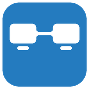

# LAN remote (`dsh-lan-remote`)

Use this computer's DSH from another computer's browser on the same LAN, and keep the links of other computers' DSH for one-click access.

It appears under **Settings → LAN remote**.



## What it does

- **Share this computer** — starts a small HTTP/WebSocket gateway on `0.0.0.0:<port>` (4778 by default) that transparently proxies to this machine's DSH Web server on `127.0.0.1:50590`. Share links look like `http://192.168.1.8:4778/?lan=ABCD-1234`.
- **Other computers** — saves shared links, probes whether a peer is reachable, and opens it in a new browser tab.
- **Access code** — resettable at any time; the port is editable.
- **Durable state** — port, code, sharing switch, and the saved peer list live on disk; sharing is restored after a DSH restart.

## Install

Through `plugin_manager` (pin a commit for a predictable upgrade; `858dd4e` is tag `v1.0.0`):

```text
plugin_manager action=install_bundle target=git+https://github.com/X1aoM1ngTX/dsh-lan-remote.git#858dd4e10a7d80bd19d252820eb23ef7705bd104
```

Or the default branch:

```text
plugin_manager action=install_bundle target=git+https://github.com/X1aoM1ngTX/dsh-lan-remote.git
```

For local development, point at the directory:

```text
plugin_manager action=install_bundle target=/absolute/path/to/dsh-lan-remote
```

Refresh the page afterwards, then open **Settings → LAN remote**.

## Usage

1. Install this plugin on every participating computer.
2. On the computer you want to reach: **Settings → LAN remote**, turn on *Share this computer*, and copy the share link it shows.
3. On the computer you are sitting at: paste that link under *Other computers*, press *Test* to confirm reachability, then *Connect*.
4. If the other computer cannot connect, open *Another computer cannot connect?* and run the one-line administrator PowerShell firewall command it prints.

## How it works

The gateway neither moves DSH's bind address nor implements a login of its own:

1. The browser talks to the gateway; the gateway rewrites `Host`, `Origin`, and `Referer` to the loopback authority and forwards to the DSH Web server.
2. The gateway checks the `?lan=<code>` in the share link and exchanges it for the DSH process's own launch token.
3. DSH mints its own browser cookie from that token; every later HTTP and WebSocket request is authenticated by DSH, not by the gateway.

So **DSH still owns authentication**; the gateway only rewrites addresses and adds the access-code gate.

## Security

- The share link is the credential. While sharing is on, anyone on the LAN who has the link can use this DSH as if they were at this computer: read and write files, run commands, and use the signed-in account.
- Turn it on only in a trusted network, turn it off when unused, and share the link only with people you trust.
- *New code* invalidates old links but does **not** sign out browsers that already authenticated; their cookies last up to 30 days.
- The gateway serves plain HTTP; do not use it on an untrusted network.

## State

`$DSH_HOME/lan-remote/state.json` holds the port, access code, sharing switch, and peer list. The plugin never stores DSH tokens or cookies.

## Known limitations

- The remote UI opens in a **new tab** rather than an embedded frame: a cross-site iframe is blocked by third-party cookie policy.
- No automatic discovery yet; the link is pasted once by hand.
- The firewall hint is only verified on Windows.
- Traffic between the remote browser and DSH is plain HTTP.

## Sharing and listing

- The repository root is the package root, and `package.json` declares `dsh.bundle`, so DSH can install it as-is.
- [docs/awesome-dsh-plugin.yml](docs/awesome-dsh-plugin.yml) holds the community directory entry: copy it to `data/plugins/X1aoM1ngTX__dsh-lan-remote.yml` in a fork of `awesome-dsh-plugin` and open a pull request.
- Once listed, community indexes (such as `aaamechanic.github.io/dsh-plugin-market/index.json`) mirror it automatically; anyone can also host a format-1 index and add its URL under **Plugins → Discover → Add index source**.

## Files

| File | Role |
|---|---|
| `index.js` | Host half: gateway, state, `/__lan_remote/api/*` |
| `client.js` | Client half: the settings page (React, no JSX, theme tokens only) |
| `cordis.patch.yml` | The plugin row inserted on install |
| `locale/*.json` | Inventory title, description, and detail document |
| `docs/*.md` | Long description (`meta.detail`) and the directory entry |
| `assets/icon-180.png` | Storefront / directory tile |

中文说明见 [README.md](README.md)。
